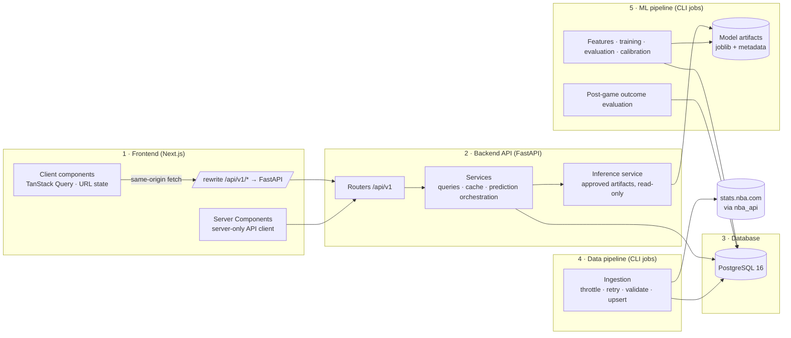

# Architecture

NBA Intelligence predicts an NBA player's next-game box score (points, rebounds, assists, threes, steals, blocks, minutes, double-double probability) from information available before tip-off, and exposes the data, predictions and their measured accuracy through a web application.

Related documents:

- [database.md](database.md) — PostgreSQL schema
- [api-contracts.md](api-contracts.md) — REST contracts, errors, caching, screen data loading
- [model-methodology.md](model-methodology.md) — features, training, evaluation, intervals, inference
- [frontend.md](frontend.md) — design system, accessibility, state boundaries
- [data-ownership.md](data-ownership.md) — source of truth and state ownership
- [data-synchronization.md](data-synchronization.md) — scheduler, game lifecycle, freshness, prediction refresh
- [decisions/](decisions/) — architecture decision records
- [implementation-status.md](implementation-status.md) — 15-phase status ledger and quality gates (authoritative for progress)

## System diagram

Five layers: Next.js frontend, FastAPI backend, PostgreSQL, data ingestion pipeline, machine learning pipeline.



Request path: the browser only talks to the Next.js origin. Next.js rewrites `/api/v1/*` to FastAPI, so the backend address never reaches the browser and CORS stays closed in production. Server Components call FastAPI over the internal network with a server-only client.

Offline path: ingestion, training and outcome evaluation are CLI commands (`python -m app.cli ...`) run by a scheduler. There are **no HTTP endpoints that trigger ingestion, training or database administration**, so the public surface cannot start them.

## Ownership

Every data category has exactly one writer and one authoritative source. The full layer matrix, source-of-truth table, statistic definitions, state boundaries and conflict-resolution rules are in [data-ownership.md](data-ownership.md).

## NBA data source findings

Verified against live `nba_api` 1.12.0 from a residential connection on 2026-10-28:

| Endpoint | Use | Observed |
|---|---|---|
| `LeagueGameLog` (P) | Player box scores, one call per season and season type | 2025-26: 26,651 rows · 2018-19: 26,101 · 2026-27: 1,275 (Oct 20–27) |
| `LeagueGameLog` (T) | Team box scores (pace, defensive strength) | 2025-26: 2,460 rows |
| `ScheduleLeagueV2` | Season schedule, status, UTC tip-off, arena | 2026-27: 1,274 rows |
| `LeagueDashTeamStats` (Advanced) | Reference PACE / DEF_RATING | 30 rows; current season-to-date snapshot only |
| `CommonPlayerInfo` | Per-player bio and position | ~0.1 s per player |
| `nba_api.stats.static` | Offline player and team ids | 5,198 players (519 active), 30 teams |

Limitations and how the design handles them:

1. **Cloud IP blocking.** stats.nba.com is widely reported to reject or time out requests from cloud-provider IP ranges. Every call above succeeded from this machine, but cloud behavior is unverified. Ingestion is a standalone job that can run anywhere with database access (local machine, self-hosted runner, small VM) and writes to the production database. The web app never calls the NBA API, so serving is unaffected.
2. **No published rate limit or SLA.** The client throttles to about 1 request/s and uses timeouts, exponential backoff with jitter (at most 5 attempts) and an on-disk response cache for completed seasons. On failure, the API keeps serving the last verified data with its `last_successful_sync` timestamp.
3. **Players who did not play are absent.** `LeagueGameLog` only lists players who appeared. DNPs and injuries are inferred from team games that have no row for that player.
4. **No injury or lineup feed in nba_api.** Predictions are **conditional on the player playing**, and the UI says so. Minutes variance is part of each interval.
5. **Season-snapshot endpoints leak future data.** `LeagueDashTeamStats` returns *current* totals. Opponent defensive strength and pace are recomputed from team game logs using only games before each target date. The snapshot endpoint is display-only.
6. **Home/away is not a column.** It's derived from `MATCHUP` (`"GSW vs. LAL"` = home, `"GSW @ LAL"` = away) and cross-checked against the schedule's team ids.
7. **True usage rate needs per-game advanced box scores** (~1,230 calls per season). A box-score usage proxy is computed from ingested player and team totals: `(FGA + 0.44·FTA + TOV) / team(FGA + 0.44·FTA + TOV)`.
8. **Player photos.** NBA CDN headshots are NBA property. The app neither ships nor rehosts them and falls back to a monogram avatar. Whether to show CDN headshots is a deployment-time decision, disclosed on the About page.
9. **Mid-season trades.** Team is recorded per game (`player_game_stats.team_id`), not only on the player row.

## Supported seasons

Regular season and playoffs from **2018-19 through the current 2026-27 season**. Play-in games are stored as their own season type. 2019-20 (bubble) and 2020-21 (shortened) are kept but flagged, and evaluation reports results per season so their effect is visible. Preseason and All-Star games are excluded.

## Repository layout

```
nba-intelligence/
├── backend/
│   ├── pyproject.toml
│   ├── alembic.ini
│   ├── alembic/versions/
│   ├── app/
│   │   ├── main.py            app factory, middleware, error handlers
│   │   ├── config.py          pydantic-settings, env-based
│   │   ├── db.py              engine, sessions, pooling
│   │   ├── logging.py         structured JSON logs with request ids
│   │   ├── cli.py             ingest / train / evaluate commands
│   │   ├── models/            SQLAlchemy ORM
│   │   ├── schemas/           Pydantic contracts
│   │   ├── api/v1/            players, teams, games, predictions, compare, models, system, overview
│   │   ├── stats/             single definitions of derived statistics
│   │   ├── services/          queries, cache, prediction orchestration
│   │   ├── ingestion/         nba_api client, transforms, upsert jobs
│   │   └── ml/                features, datasets, training, intervals, registry, inference
│   ├── artifacts/             model files (git-ignored)
│   └── tests/{unit,integration,ml}
├── frontend/
│   ├── src/app/               routes (App Router)
│   ├── src/components/ui/     accessible primitives (shadcn/ui based)
│   ├── src/components/charts/ chart wrappers with table alternatives
│   ├── src/lib/api/           server.ts, client.ts, generated types
│   └── tests/{unit,e2e}
├── docker-compose.yml
├── .github/workflows/ci.yml
└── docs/
```

## Architecture decisions

| Decision | Reason |
|---|---|
| Season-level `LeagueGameLog` instead of per-player logs | 2 calls per season instead of ~500; far less throttling exposure |
| Ingestion and training as CLI jobs, not HTTP | No public path to expensive or administrative work |
| Next.js rewrite proxy for browser calls | Same origin, no public CORS, backend address hidden |
| One feature function for training and inference | Prevents training/serving skew |
| Append-only prediction records with feature snapshots | Every prediction is reproducible and auditable |
| Data-version-keyed in-process cache, no Redis | Invalidation is automatic when an ingestion run commits; one fewer service |
| TypeScript types generated from OpenAPI (`openapi-typescript`) | One source of truth for API contracts |
| Recharts over ECharts | React composition; easier to make accessible and to theme with tokens |
| `pg_trgm` trigram index for player search | Typo-tolerant search without a separate search service |
| Homebrew Postgres locally, containers in CI and production | Docker is not installed on the dev machine; CI uses a `postgres:16` service |
| SF Pro via system font stack only | SF Pro may not be self-hosted on the web; `-apple-system` renders it on Apple devices, Inter elsewhere |
