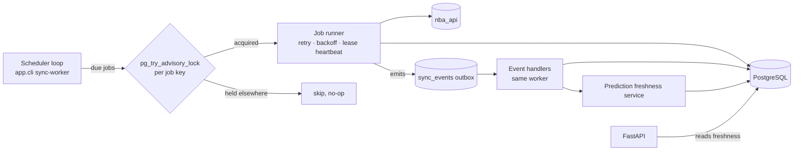

# Data Synchronization & Prediction Freshness

How NBA Intelligence keeps schedules, results, box scores and predictions current without manual refreshes, and without breaking prediction immutability ([ADR 0003](decisions/0003-immutable-predictions.md)).

**Implementation status:** designed, not implemented. It is built as part of Phase 3 (scheduler, jobs, lifecycle, freshness, corrections) and Phase 7 (prediction freshness and refresh). See [implementation-status.md](implementation-status.md). Nothing here is claimed to work until those phases record test evidence.

## Components

- **One worker process** (`python -m app.cli sync-worker`) runs the scheduler loop and event handlers. It runs separately from the API, so web replicas never poll the NBA.
- **No broker.** Events are rows in `sync_events`, an outbox the worker drains in order. Kafka or RabbitMQ would add an always-on service for a few hundred events a day.
- **Multi-instance safety.** Before running, each job takes a PostgreSQL session advisory lock keyed by a hash of its job key. A second worker (accidental double deploy, overlapping restart) skips that job. In-memory locks are not relied on.
- **Restart recovery.** `sync_schedules.next_run_at` is persisted. A restarted worker runs anything overdue once (no backlog replay), and marks `running` runs whose lease heartbeat is older than 2 minutes as `abandoned` before retrying them.

## Schedule (configurable defaults)

Times are UTC internally. The NBA "game day" is computed in `America/New_York`, which covers DST transitions.

| Job key | Default | Active window | Source |
|---|---|---|---|
| `schedule` | 30 min | Always during season | `ScheduleLeagueV2` |
| `live_scores` | 60 s | Only while some game has `tipoff_at − 15 min ≤ now` and is not final, plus a 4-hour cap per game | `nba_api.live` scoreboard (cdn.nba.com) **if reachable and permitted**; otherwise disabled and live status comes from the schedule job |
| `final_results` | 10 min | From tip-off + 2 h until every game of that game day is `final` | Schedule + `LeagueGameLog` for the date |
| `player_box_scores` | 15 min | After a game turns `final`, until two consecutive identical fetches mark it `stats_finalized` (max 24 h) | `LeagueGameLog` |
| `metadata` | 24 h | Always | Static teams, `PlayerIndex` / `CommonPlayerInfo` |
| `corrections` | 7 days | Always | Re-fetch the last 30 days of final games |
| `prediction_freshness` | 15 min | Games with tip-off in the next 48 h | Internal |
| `retrain_eligibility` | 7 days | Always | Internal (records eligibility only; training stays a manual CLI step per [ADR 0002](decisions/0002-no-http-admin-operations.md)) |

The worker sleeps when nothing is due. Outside the season, only `metadata` and `corrections` run. These cadences are polling intervals, not provider freshness guarantees. The UI never says "real time."

## Game lifecycle

`games.status`: `scheduled → delayed → in_progress → final`, with side exits `postponed` and `cancelled`. Each game also stores `provider_status` (raw `gameStatus` + `gameStatusText`), `status_observed_at` and `stats_finalized_at`.

| From | Allowed to | Note |
|---|---|---|
| scheduled | delayed, in_progress, postponed, cancelled, final | `final` directly when a game was missed between polls |
| delayed | in_progress, postponed, cancelled, scheduled | |
| in_progress | final, postponed | Suspended games are treated as postponed |
| postponed | scheduled (new `tipoff_at`), cancelled | Same `game_id` when the provider reuses it |
| final | final | Never downgraded. A stale non-final response is ignored and logged |
| cancelled | none | Terminal |

Every transition emits an event. Illegal transitions are rejected, logged, and counted in the run's `rows_rejected`.

## Events

| Event | Emitted when | Handler effects (all idempotent) |
|---|---|---|
| `GAME_SCHEDULE_UPDATED` | A tip-off, teams or status changed | Mark affected pregame predictions; bump `data_version` |
| `GAME_STARTED` | → `in_progress` | Close pregame window: no new pregame predictions; freeze the final pregame prediction per player |
| `GAME_COMPLETED` | → `final` | Enqueue box-score ingestion for the game |
| `GAME_STATS_FINALIZED` | Box score stable across two fetches | Write `prediction_evaluations`; refresh `model_evaluations` live slice |
| `PLAYER_STATS_UPDATED` | New or changed player lines | Invalidate player caches; recheck freshness of that player's upcoming predictions |
| `HISTORICAL_DATA_CORRECTED` | Correction detected | Log in `source_corrections`; re-score evaluations; invalidate caches |
| `PREDICTION_STALE` | Freshness service detected change | Regenerate if inside the pregame window |
| `INGESTION_FAILED` | Run ended `failed` | Freshness becomes `stale` or `unavailable` once thresholds pass |

`sync_events` has a unique `dedupe_key` (e.g. `GAME_COMPLETED:0022600123`), so re-emitting an event is a no-op.

### Game finalization sequence

1. Upsert the game row (`final`, scores).
2. Ingest the box score in one transaction; validate.
3. Statistics are derived on read (`app/stats`), so nothing needs recomputing in storage.
4. Bump `data_version`, which invalidates cached aggregates.
5. Once `stats_finalized`, write `prediction_evaluations` for every pregame and backtest prediction of that game. Prediction rows are untouched.
6. Refresh the live-evaluation summary.
7. The frontend picks up changes through the new `data_version` (Next.js `revalidate` and TanStack Query `staleTime`); no push channel is needed.

## Freshness tracking

Per dataset: `schedule`, `live_scores`, `final_box_scores`, `player_game_logs`, `season_stats`, `team_stats`, `prediction_features`, `predictions`.

Derived from `ingestion_runs` (one row per execution) and exposed by `GET /api/v1/data-status` and `meta.data_freshness`:

| Field | Source |
|---|---|
| `last_successful_sync` | Latest `succeeded` run `finished_at` |
| `last_attempted_sync` | Latest run `started_at` |
| `source_updated_at` | Max provider timestamp seen, when the source gives one |
| `status` | `fresh` / `aging` / `stale` / `unavailable` |
| `last_error` | Sanitized message from the latest failed run (no stack traces) |
| `coverage` | Earliest and latest `game_date` stored |

Status thresholds are configurable per dataset (`FRESHNESS__<DATASET>__AGING`, `__STALE`). Defaults are twice and four times the job interval while the job's window is active. `unavailable` means the last 3 attempts failed and no success exists within the stale window.

## Prediction freshness

Predictions are never modified. Freshness is a derived state computed from the stored snapshot and current data:

| State | Meaning | Detection |
|---|---|---|
| `current` | Latest prediction for this player and game; inputs unchanged | Snapshot hash equals a freshly built snapshot |
| `stale` | Inputs changed or older than `PREDICTION_MAX_AGE` (default 12 h) | New completed games for the player or opponent, a feature change, or age |
| `invalid` | The matchup changed | Player changed teams, opponent changed, or game postponed or cancelled |
| `superseded` | A newer prediction exists | Another row has `supersedes_prediction_id` pointing at this one |
| `final_pregame` | Last pregame prediction made before tip-off | Latest `pregame` row with `created_at < tipoff_at`; used for evaluation |

Dependency-aware refresh: the freshness job only checks predictions for games in the next 48 h whose player, team or opponent appears in events since the prediction's `data_cutoff_at`, plus those past the age limit. When regeneration is needed and `now < tipoff_at`, a new row is inserted with `supersedes_prediction_id` set. After tip-off nothing is generated, and the API returns 409 `game_already_started`.

Automatic generation covers **only players someone has already requested** for that game. The system does not predict every player in the league ([api-contracts.md](api-contracts.md#prediction-contract)). An active-model change makes predictions `stale` but does not regenerate them automatically.

## Failure handling

| Class | Examples | Behavior |
|---|---|---|
| Retryable | Timeout, connection reset, 429, 5xx | Exponential backoff with full jitter (1 s base, 60 s cap, ≤ 5 attempts); `Retry-After` honored when present |
| Non-retryable | 4xx other than 429, schema mismatch, validation failure | Fail immediately; record the error; no retries |
| Partial | Fewer rows than already stored for completed games | Run fails without writing ([data-ownership.md](data-ownership.md#nba-data-provenance-and-reconciliation)) |
| DB outage | Connection refused mid-run | Transaction rolls back; run marked `failed` on the next connection; next schedule retries |
| Interrupted | Worker killed | Lease expires → `abandoned` → rerun; upserts make the rerun safe |

Each batch is one transaction. Previously committed data stays readable throughout, and the API serves it with its freshness status.

## Corrections

The weekly `corrections` job re-fetches final games from the last 30 days and compares normalized values column by column. Differences are written to `source_corrections`, the authoritative row is updated, and `HISTORICAL_DATA_CORRECTED` is emitted. Evaluation rows are re-scored; prediction rows and their feature snapshots are not touched.

## Monitoring

`ingestion_runs` records job key, status, start, finish, duration, `rows_fetched`, `rows_inserted`, `rows_updated`, `rows_rejected`, `retry_count`, `error`. `sync_schedules` records `next_run_at`. These are readable through the CLI (`app.cli sync-status`) and summarized publicly by `/data-status`, which shows freshness only: no hostnames, credentials or traces. There is no public control endpoint.

## Frontend indicators

`FreshnessBadge` and prediction labels map states to short text: "Updated 5 min ago", "Final", "Data temporarily unavailable · showing results through Oct 27", "Made before tip-off", "Newer prediction available". They are static text, with no toasts or animation.

## Tests (added with Phases 3 and 7)

All use recorded provider fixtures and simulated failures; CI never calls the live NBA API.

- Scheduler: due-job selection, active windows, sleep when idle
- Duplicate prevention: two workers, one advisory lock; the job runs once
- Retry: retryable vs non-retryable errors, backoff bounds, `Retry-After`, attempt cap
- Rollback: failure mid-batch leaves prior data unchanged
- Partial response rejected
- Lifecycle: every allowed and forbidden transition; no downgrade from `final`
- Corrections: detected, logged, evaluations re-scored, predictions untouched
- Prediction freshness: stale, invalid, superseded and final-pregame classification; no pregame rows after tip-off
- Cache invalidation on `data_version` bump
- Restart recovery: abandoned lease rerun; overdue jobs run once
- Time zones: game-day boundaries across the March and November DST changes
