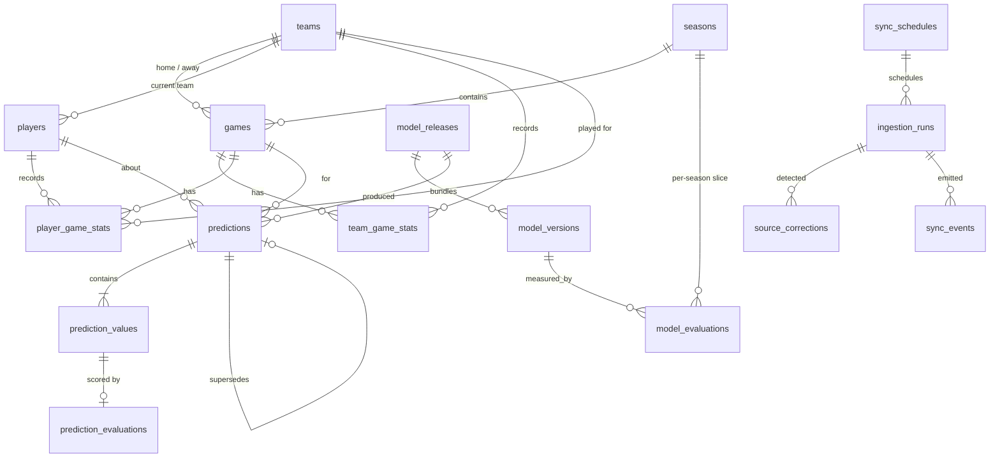

# Database Schema

PostgreSQL 16. All tables are managed by Alembic migrations in `backend/alembic/versions/`. NBA ids are used as natural primary keys for NBA entities, so re-ingesting a record upserts instead of duplicating it.

## Entity relationships

### Provenance columns

`players`, `games`, `team_game_stats` and `player_game_stats` also carry these columns. They are omitted from the tables below for brevity:

| Column | Type | Notes |
|---|---|---|
| ingestion_run_id | bigint FK → ingestion_runs | Run that last wrote the row |
| source_endpoint | varchar(48) | e.g. `LeagueGameLog`, `ScheduleLeagueV2` |
| first_ingested_at | timestamptz | Set on insert, never updated |
| updated_at | timestamptz | Set on every changing upsert |

Upserts use `ON CONFLICT … DO UPDATE … WHERE (row) IS DISTINCT FROM (excluded)`, so an unchanged re-ingest touches nothing and leaves `updated_at` and `ingestion_run_id` alone. Reconciliation rules are in [data-ownership.md](data-ownership.md).

## Tables

Types are PostgreSQL types. `PK` = primary key, `FK` = foreign key, `UQ` = unique.

### Reference data (written by ingestion)

**seasons**

| Column | Type | Notes |
|---|---|---|
| id | smallint PK | Start year, e.g. `2025` for 2025-26 |
| label | varchar(7) UQ | `"2025-26"` |
| start_date, end_date | date | Regular-season bounds |
| is_atypical | boolean | `true` for 2019-20 and 2020-21 |

**teams**

| Column | Type | Notes |
|---|---|---|
| id | integer PK | NBA team id |
| abbreviation | varchar(3) UQ | |
| city, name | varchar | |
| conference, division | varchar | |
| primary_color, secondary_color | char(7) | Hex; used for accents, never as the only signal |

**players**

| Column | Type | Notes |
|---|---|---|
| id | integer PK | NBA person id |
| full_name, first_name, last_name | varchar | GIN `gin_trgm_ops` index on `full_name` for fuzzy search |
| position | varchar(16) null | |
| height_inches, weight_lbs | smallint null | |
| birthdate | date null | |
| is_active | boolean | |
| current_team_id | integer FK → teams null | Display only; per-game team is on `player_game_stats` |
| from_year, to_year | smallint null | |
| updated_at | timestamptz | |

**games**

| Column | Type | Notes |
|---|---|---|
| id | varchar(10) PK | NBA game id, e.g. `0022500001` |
| season_id | smallint FK → seasons | |
| season_type | enum `regular \| playin \| playoffs` | |
| game_date | date | Local (ET) game date as published |
| tipoff_at | timestamptz null | From schedule (UTC); used as the prediction cutoff |
| home_team_id, away_team_id | integer FK → teams | `CHECK (home_team_id <> away_team_id)` |
| status | enum `scheduled \| delayed \| in_progress \| final \| postponed \| cancelled` | Lifecycle rules in [data-synchronization.md](data-synchronization.md#game-lifecycle) |
| provider_status | jsonb | Raw `gameStatus` / `gameStatusText` last observed |
| status_observed_at | timestamptz | When the current status was first observed (unchanged re-syncs don't touch the row) |
| stats_finalized_at | timestamptz null | Box score stable across two fetches |
| home_score, away_score | smallint null | Null until final |
| arena | varchar null | |
| source_updated_at | timestamptz | Last time the source changed this row |

Indexes: `(game_date)`, `(season_id, season_type)`, `(home_team_id, game_date)`, `(away_team_id, game_date)`, partial `(tipoff_at) WHERE status = 'scheduled'`.

**team_game_stats** — PK `(game_id, team_id)`

| Column | Type | Notes |
|---|---|---|
| game_id | varchar(10) FK → games | |
| team_id | integer FK → teams | |
| is_home | boolean | |
| minutes | smallint | 240 + 25 per overtime |
| fgm, fga, fg3m, fg3a, ftm, fta, oreb, dreb, reb, ast, stl, blk, tov, pf, pts | smallint | |
| plus_minus | smallint | |

`possessions` is computed in queries (`fga - oreb + tov + 0.44 * fta`) rather than stored, so it cannot go stale.

**player_game_stats** — PK `(game_id, player_id)`

| Column | Type | Notes |
|---|---|---|
| game_id | varchar(10) FK → games | |
| player_id | integer FK → players | |
| team_id | integer FK → teams | Team the player played for in this game |
| minutes | numeric(5,2) | Decimal minutes |
| fgm, fga, fg3m, fg3a, ftm, fta, oreb, dreb, reb, ast, stl, blk, tov, pf, pts | smallint | `CHECK` non-negative, `fgm <= fga`, etc. |
| plus_minus | smallint null | |

Indexes: `(player_id, game_id)` covering the per-player game log, `(team_id, game_id)`. Shooting percentages are derived, not stored. A trigger-free `CHECK` set rejects impossible box scores at insert.

### Operational data

**ingestion_runs**

| Column | Type | Notes |
|---|---|---|
| id | bigserial PK | |
| job | varchar | Job key, e.g. `schedule`, `final_results`, `player_box_scores`, `corrections` |
| params | jsonb | e.g. `{"season": "2025-26", "season_type": "regular"}` |
| status | enum `running \| succeeded \| failed \| abandoned` | `abandoned` = lease expired |
| heartbeat_at | timestamptz | Lease heartbeat while running |
| retry_count | smallint | |
| started_at, finished_at | timestamptz | |
| rows_fetched, rows_valid, rows_inserted, rows_updated, rows_rejected | integer | Reconciliation counts for the Phase 3 gates |
| error | text null | |

**sync_schedules** — PK `job`

| Column | Type | Notes |
|---|---|---|
| job | varchar PK | |
| interval_seconds | integer | Configurable default |
| next_run_at | timestamptz | Persisted for restart recovery |
| enabled | boolean | |

**sync_events** — outbox

| Column | Type | Notes |
|---|---|---|
| id | bigserial PK | |
| type | enum (8 event types in [data-synchronization.md](data-synchronization.md#events)) | |
| dedupe_key | varchar UQ | e.g. `GAME_COMPLETED:0022600123` |
| payload | jsonb | |
| ingestion_run_id | bigint FK → ingestion_runs null | |
| created_at, processed_at | timestamptz | `processed_at` null until handled; partial index on unprocessed |

**source_corrections**: an audit log of changes to previously stored values

| Column | Type | Notes |
|---|---|---|
| id | bigserial PK | |
| ingestion_run_id | bigint FK → ingestion_runs | |
| table_name | varchar | |
| record_key | jsonb | e.g. `{"game_id": "0022500001", "player_id": 201939}` |
| column_name | varchar | |
| old_value, new_value | text | |
| detected_at | timestamptz | |

`data_version` = the id of the latest succeeded run. API cache keys include it, so a committed ingestion invalidates dependent caches. Freshness per dataset = latest succeeded `finished_at` for that job.

### Model registry (written by the ML pipeline)

**model_releases** — one deployable bundle of per-stat models

| Column | Type | Notes |
|---|---|---|
| id | uuid PK | |
| version | varchar UQ | e.g. `2026.10.28-1` |
| feature_schema_version | varchar | Hash of feature names, dtypes and feature code version |
| train_start, train_end, val_start, val_end, test_start, test_end | date | Chronological split boundaries |
| data_version | bigint | `ingestion_runs.id` the training data was read at |
| git_sha | varchar(40) null | |
| status | enum `candidate \| active \| retired` | Partial unique index: at most one `active` |
| created_at, activated_at | timestamptz | |

**model_versions** — one trained model per target and algorithm, including non-selected candidates

| Column | Type | Notes |
|---|---|---|
| id | uuid PK | |
| release_id | uuid FK → model_releases | |
| target | enum `pts \| reb \| ast \| fg3m \| stl \| blk \| min \| double_double` | |
| algorithm | enum `rolling_baseline \| ridge \| random_forest \| xgboost \| logistic \| xgboost_classifier` | |
| is_selected | boolean | UQ `(release_id, target) WHERE is_selected` |
| hyperparameters | jsonb | |
| features | jsonb | Ordered feature list |
| interval_calibration | jsonb null | Conformal quantiles per bin |
| artifact_path | varchar | Relative to `ARTIFACTS_DIR` |
| artifact_sha256 | char(64) | Verified on load |
| random_seed | integer | |

**model_evaluations** — UQ `(model_version_id, split, season_id)`

| Column | Type | Notes |
|---|---|---|
| id | bigserial PK | |
| model_version_id | uuid FK → model_versions | |
| split | enum `validation \| test` | |
| season_id | smallint FK → seasons null | Null = whole split |
| n_observations | integer | |
| mae, rmse, r2 | double precision null | Regression targets |
| interval_level | numeric(3,2) null | e.g. `0.80` |
| interval_coverage | double precision null | Empirical |
| brier, log_loss | double precision null | Double-double |
| baseline_mae | double precision null | Same observations as this row |
| created_at | timestamptz | |

### Predictions

**predictions** — append-only

| Column | Type | Notes |
|---|---|---|
| id | uuid PK | |
| player_id | integer FK → players | |
| game_id | varchar(10) FK → games | |
| release_id | uuid FK → model_releases | |
| kind | enum `pregame \| backtest` | Backtests are never shown as pregame predictions |
| status | enum `ok \| insufficient_data \| model_unavailable` | Non-`ok` rows carry no values |
| feature_schema_version | varchar | |
| feature_snapshot | jsonb | Exact feature vector used |
| feature_snapshot_sha256 | char(64) | |
| explanation | jsonb null | Top feature contributions per target |
| data_cutoff_at | timestamptz | Latest source timestamp included in features |
| created_at | timestamptz | |
| double_double_probability | double precision null | `CHECK (0 <= p <= 1)` |
| supersedes_prediction_id | uuid FK → predictions null | Set when a refresh replaces an earlier pregame prediction; the earlier row is unchanged |

Constraints:

- `UQ (player_id, game_id, release_id, kind, feature_snapshot_sha256)` — identical requests reuse the stored prediction (the cache).
- `CHECK (kind = 'backtest' OR data_cutoff_at <= created_at)`.
- Pregame rule, enforced in the service and covered by tests: a pregame prediction is only created while `now() < games.tipoff_at`. No `UPDATE` path exists in application code.

Indexes: `(player_id, created_at DESC)`, `(game_id)`, `(release_id, kind)`.

**prediction_values** — PK `(prediction_id, stat)`

| Column | Type | Notes |
|---|---|---|
| prediction_id | uuid FK → predictions ON DELETE RESTRICT | |
| stat | enum `pts \| reb \| ast \| fg3m \| stl \| blk \| min` | |
| point | double precision | |
| lower, upper | double precision | `CHECK (lower <= point AND point <= upper)` |
| interval_level | numeric(3,2) | |

**prediction_evaluations** — PK `(prediction_id, stat)`, written after the game is final

| Column | Type | Notes |
|---|---|---|
| prediction_id, stat | FK → prediction_values | `stat` also allows `double_double` |
| actual | double precision | For `double_double`, 0 or 1 |
| abs_error | double precision | For `double_double`, the Brier term `(p − actual)²` |
| within_interval | boolean null | |
| evaluated_at | timestamptz | |

If a player did not play, no evaluation row is written. The prediction stays visible as "did not play" and is excluded from accuracy metrics.

## Integrity rules

- Every upsert is `INSERT … ON CONFLICT (natural key) DO UPDATE` inside one transaction per ingestion batch. A failed run rolls back its batch and leaves previously committed data intact.
- Foreign keys use `ON DELETE RESTRICT` throughout; nothing cascades away historical data.
- `pg_trgm` is enabled by the first migration.
